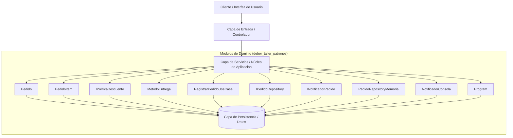

# Blueprint de Arquitectura: deber_taller_patrones

- **Fecha de diseño:** 2026-10-25 13:17
- **Arquitecta:** Gaby (Asistente de Arquitectura de Software de Alen)
- **Patrón Seleccionado:** **Clean Architecture / Arquitectura Hexagonal (Ports & Adapters)**
- **Stack Tecnológico Principal:** C# / .NET / Blazor

---

## 1. Visión y Contexto del Sistema
Sistema de registro de pedidos en C# (.NET) organizado en capas Domain, Application e Infrastructure con un composition root en Program.cs. Aplica Dependency Inversion (IPedidoRepository, INotificadorPedido), Strategy para descuentos (IPoliticaDescuento con SinDescuento y DescuentoVip) y Liskov con jerarquia MetodoEntrega (RetiroLocal, EnvioDomicilio) mas la interfaz segregada IEntregaConDireccion.

### ¿Por qué Clean Architecture / Arquitectura Hexagonal (Ports & Adapters)?
Aísla la lógica de negocio (Dominio y Casos de Uso) de bases de datos, UI y frameworks mediante inversión de dependencias.

---

## 2. Diagrama de Arquitectura de Componentes (Mermaid)



---

## 3. Estructura de Directorios Recomendada

```text
Solucion/
├── Domain/            # Entidades y reglas de negocio puras
├── Application/       # Casos de uso, servicios, DTOs, validadores
├── Infrastructure/    # EF Core, repositorios, migraciones, integraciones
├── API/               # Controladores delgados, middlewares, ExceptionMiddleware con ILogger
├── Blazor/            # UI (Pages/Components/Services con Result<T>)
├── Tests/             # Proyecto de pruebas (servicios críticos y validadores)
└── Solucion.slnx
```

---

## 4. Evaluación de Trade-offs (Concesiones de Arquitectura)

| Dimensión | Análisis Técnico |
| :--- | :--- |
| **Ventajas Clave** | Dominio 100% testeable sin base de datos; permite cambiar motor de BD o framework sin tocar reglas de negocio. |
| **Desventajas / Costos** | Mayor cantidad de capas de abstracción (DTOs, puertos, adaptadores). |
| **Estrategia de Evolución** | Ideal para sistemas con reglas de negocio complejas o larga vida útil. |

---

## 5. Reglas de Gobernanza y Calidad
1. **Responsabilidad Única (SRP):** Ningún archivo o componente UI debe superar las 300-400 líneas.
2. **Cero Secretos en Código:** Credenciales, JWT secrets y URLs de conexión viven exclusivamente en `.env`.
3. **Falla Elegante y Trazabilidad:** Prohibido `catch {}` vacíos o `return null/new()` silenciosos; registrar con `ILogger` en un `ExceptionMiddleware` y, en Blazor WASM, devolver un tipo `Result<T>` que la página muestre en lugar de relanzar con `throw;`.
4. **Prioridad de Severidad:** Seguridad y secretos → integridad de datos de negocio → higiene de Git → tests → mantenibilidad/UI. Ninguna tarea de estilo/CSS va antes de cerrar las anteriores.

---
> ✅ **[AUTO-CRÍTICA ARQUITECTÓNICA SUPERADA (Red Team Gate)]:** Coherencia verificada para stack **C# / .NET / Blazor** | Cero librerías de terceros en deuda técnica | Prioridad por severidad validada.
